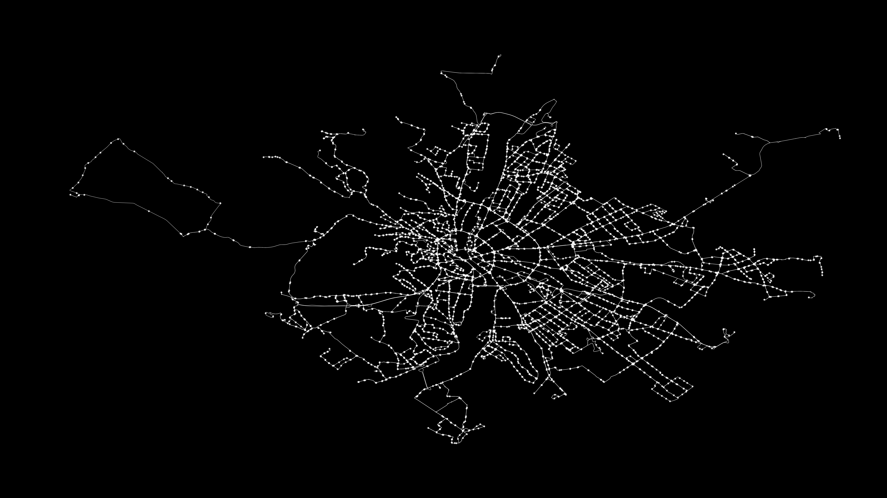
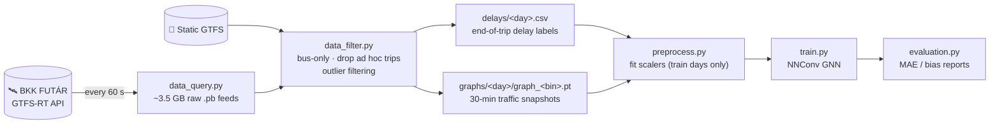
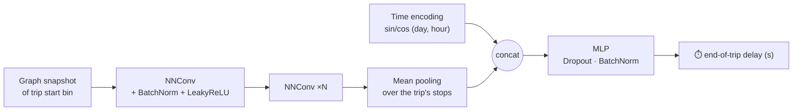
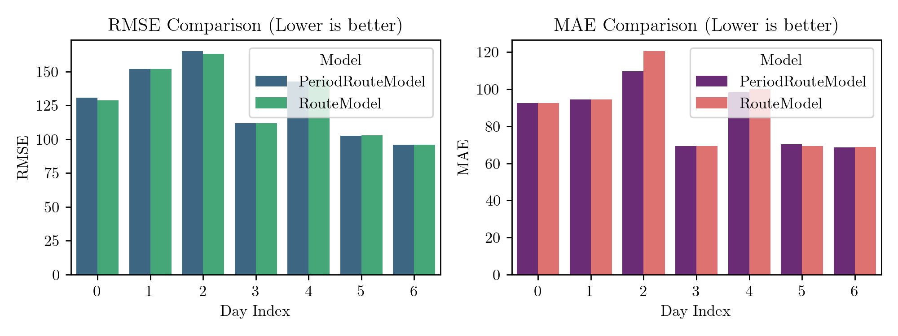
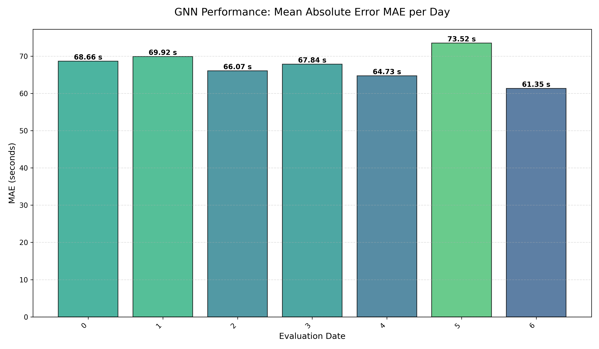

<div align="center">



# 🚌 BKK Delay Detection

**Predicting end-of-trip delays of Budapest buses with Graph Neural Networks**

[](https://www.python.org/)
[](https://pytorch.org/)
[](https://pyg.org/)
[](#-quickstart)
[](LICENSE)

*Real-time data from the [BKK FUTÁR](https://futar.bkk.hu/) GTFS-Realtime API · 30-minute traffic snapshots · NNConv GNN*

</div>

---

## ✨ What it does

Given a bus trip (route, start time, day), the model predicts **how many seconds late the bus will arrive at its final stop**.

The Budapest bus network is modelled as a **graph**: stops are nodes and consecutive stop pairs are edges. Each day is cut into **30-minute snapshots**, and every snapshot stores how delayed the vehicles passing each stop were. A GNN reads the traffic state of the whole city, focuses on the stops of the trip in question, and regresses the final delay.

| Model | Inputs | MAE ↓ |
|---|---|---|
| Route mean (baseline) | route | 88.9 s |
| Route × period mean (baseline) | route, time of day | 86.2 s |
| **NNConv GNN (this repo)** | **city-wide graph + trip stops + time** | **66.1 s** (−23%) |

<sub>Evaluated on 49,735 held-out trips (run `run_20251219_104026`).</sub>

---

## 📡 Data source – BKK FUTÁR API

All data comes from the official open data of **BKK** (Budapest Centre for Transport):

- **Static GTFS** – routes, trips, stops, stop times, shapes ([BKK Open Data](https://opendata.bkk.hu/))
- **GTFS-Realtime `VehiclePositions`** – live vehicle positions and delays, polled **every minute for ~3 weeks**:
  ```
  https://go.bkk.hu/api/query/v1/ws/gtfs-rt/full/VehiclePositions.pb?key=<API_KEY>
  ```

API keys can be requested for free on the [BKK Open Data portal](https://opendata.bkk.hu/). The collector script reads the key from an environment variable:

```bash
export BKK_API_KEY=<your-key>
python src/data_query.py
```

---

## 🔄 Pipeline



### Graph snapshot

| Element | Features |
|---|---|
| **Node** = stop | `lon`, `lat` + per 30-min bin: delay `count`, `mean`, `std`, `max`, `min` |
| **Edge** = stop → next stop | `distance`, `average_travel_time` |
| **Time** | sin/cos of day-of-week and time-of-day (midnight-cliff safe) |

---

## 🧠 Model



- **NNConv** layers turn edge features (distance, travel time) into per-edge weights, so messages depend on the road segment.
- **Trip-level pooling** keeps only the nodes on the trip's stop sequence, which makes the city-wide embedding specific to this trip.
- Trained with **Huber loss**, early stopping, and scalers fitted on training days only (no leakage).

---

## 📊 Results

<table>
<tr>
<td width="50%"><br/><sub><b>Baselines</b> – route and route×period averages per weekday</sub></td>
<td width="50%"><br/><sub><b>GNN</b> – MAE per weekday on the test set</sub></td>
</tr>
</table>

The GNN reaches a **global MAE of 66.1 s** with almost no bias (+0.4 s). Errors are largest around midnight and in the evening rush hour (~18:00).

---

## 🚀 Quickstart

The data preprocessing is heavy, so the **filtered dataset is included** in `shared/data/`.

**Build**
```bash
docker build -t dl-project .
```

**Run** training + evaluation (PowerShell syntax)
```powershell
docker run --gpus all `
  -v "$(pwd)/shared:/app/shared" `
  -v "$(pwd)/log:/app/log" `
  dl-project
```
`shared/` keeps data and experiments on the host; `log/` keeps the execution logs.

**Monitor** training with TensorBoard
```bash
tensorboard --logdir=shared/experiments
```
Then open http://localhost:6006.

Hyperparameters are set in [`src/config.yaml`](src/config.yaml).

---

## 📁 Project structure

```
bkk-delay-detection/
├── main.py                  # entry point: train → evaluate
├── Dockerfile, run.sh       # containerised execution
├── src/
│   ├── config.yaml          # training & model hyperparameters
│   ├── data_query.py        # BKK FUTÁR GTFS-RT downloader
│   ├── data_filter.py       # raw GTFS → delays + graph snapshots
│   ├── preprocess.py        # scaler fitting
│   ├── train.py             # training loop, checkpoints, TensorBoard
│   ├── evaluation.py        # test-set metrics & plots
│   ├── inference.py         # prediction with historical snapshots
│   └── utils/               # logging, plotting, time helpers
├── shared/
│   ├── models.py            # NNConv GNN + MLP head
│   ├── datasets.py          # TripDataset with graph caching
│   ├── scalers.py           # feature / target standardisation
│   ├── data/                # delays/*.csv, graphs/*/*.pt, train/test split
│   └── experiments/         # runs: checkpoints, logs, eval reports
├── notebook/                # 01 EDA · 02 baselines · 03 graph · 04 training
└── assets/                  # README images
```

---

## 🔬 Methodology details

<details>
<summary><b>1. Data filtering and preparation</b></summary>

GTFS data is complex and heterogeneous. A lot of exploratory analysis (see `notebook/01_preprocess.ipynb`) went into handling edge cases such as the *midnight cliff*, incomplete trips, and ad hoc services.

- **Static GTFS:** only bus routes are kept (`route_type == 3`).
- **Dynamic GTFS:** about 14 × 24 × 60 `feed_<yyyymmdd>_<hhmmss>.pb` files per period are aggregated into one `<yyyymmdd>.csv` per day. Corrupted records and ad hoc trips missing from the static GTFS are removed.
- **Train/test split:** defined in `shared/data/records.json`.
- **Delay labels:** end-of-trip delay per tracked trip (`route_id`, `trip_id`, `delay`, `t_start`).
- **Graphs:** static edge features plus dynamic node statistics per 30-minute bin, with outlier filtering per bin.
</details>

<details>
<summary><b>2. Baselines</b></summary>

For each weekday, one day is used for training and one for testing. No graph and no neural network are involved.

- **Route model:** mean delay per route, MAE ≈ 88.87 s.
- **Route-period model:** mean delay per route and period (`[0, 6, 9, 15, 18, 24]` h), MAE ≈ 86.21 s.
</details>

<details>
<summary><b>3. Feature scaling</b></summary>

- `StandardScaler`s for node features, edge features, and the target are fitted **only on training days**, then saved and reused at evaluation and inference time.
- Two time encodings were compared:
  - min–max to `[-1, 1]` (2 features);
  - **sin/cos** with weekly and daily periods (4 features). This one has no discontinuity at midnight or between Sunday and Monday.
</details>

<details>
<summary><b>4. Data handling and batching</b></summary>

- Each epoch iterates over the training days in random order. For each day, the delay CSV is loaded and all graph snapshots of that day are cached.
- Trips whose start time has no matching snapshot are dropped.
- Batches are built with `torch_geometric.loader.DataLoader`, and pooling is done per trip with correct node-index offsets.
- **Limitation:** each trip sees a single 30-minute snapshot. A natural extension is a composite graph covering the whole trip duration.
</details>

<details>
<summary><b>5. Evaluation vs. inference</b></summary>

- **Evaluation** uses the real traffic snapshot that matches each trip's start time.
- **Inference** cannot see future traffic. It uses a historical snapshot from the same weekday and time bin as an estimate of the expected conditions.
</details>

---

## 🎓 Academic context

This project was developed as a university deep learning homework assignment (topic: *end-of-trip delay prediction*) by **Zsolt Szász**.

Highlights:
- large-scale GTFS data exploration;
- an edge-conditioned NNConv architecture;
- iterative refinement (BatchNorm, Huber loss, LeakyReLU, Dropout), which took the model from not converging to a **23% improvement** over the strongest baseline.

## 📄 License

[Apache 2.0](LICENSE)
